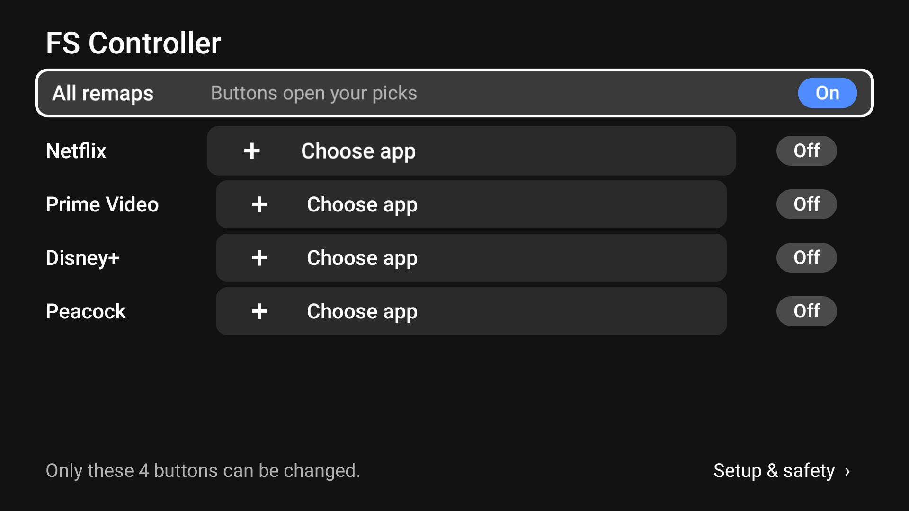

# FS Controller

Make the app buttons on your Fire TV remote open the apps **you** choose.

The Fire TV remote has four shortcut buttons (on US remotes: Netflix, Prime Video, Disney+ and Peacock). FS Controller lets you send each one to any app installed on your Fire TV. You can also turn a button off so it goes back to its normal behavior, or switch all of them off at once.



## Features

- Pick a target app for each of the 4 app buttons from the apps installed on your Fire TV.
- Turn each button's remap on or off. The app you picked is kept, so turning it back on is one press.
- An **All remaps** switch turns every remap off at once.
- A **Setup & safety** screen shows which setup steps are still missing, with the exact commands to run, and an emergency "turn everything off" command.
- Built for the remote: D-pad only, readable from the couch.
- No internet permission. Nothing leaves your Fire TV.

## How it works

Fire OS handles the four app buttons itself, before any app can see the key press. So FS Controller can't block the press. Instead, it reacts to it:

1. Fire OS writes an entry to the system log whenever one of these buttons opens an app.
2. FS Controller's background service reads those entries (this needs the `READ_LOGS` permission, which you grant once over ADB).
3. When it sees an app button's launch, it immediately opens the app you chose on top. In testing the switch was effectively instant, with no visible flash of the original app.

To be safe, it only trusts log entries written by the Android system itself (uid 1000), so other apps can't trigger it with fake entries. Opening an app from its tile on the home screen is not affected; only the remote buttons are.

## Compatibility

| | |
|---|---|
| Tested on | Fire TV Stick 4K Max (2nd gen), Fire OS 8.1.8.5 (Android 11), US remote |
| Should work on | Other Fire OS 8 devices with the same remote buttons (not tested) |
| Won't work on | Vega OS devices (they can't run Android apps) |

The button detection relies on how Fire OS logs each button's launch. Remotes in other regions, with different app buttons, or a future Fire OS update may log them differently. In that case the detection rules in `ButtonDetector.kt` need updating.

## What you need

- A Fire TV running Fire OS 8.
- A computer with [ADB (Android platform-tools)](https://developer.android.com/tools/releases/platform-tools) on the same network as the Fire TV.
- To build from source: JDK 17 or newer and the Android SDK (the build compiles against API 37; Gradle downloads what's missing once the SDK licenses are accepted).

## Build

```bash
git clone https://github.com/cfuentesb30/fs-controller.git
cd fs-controller
./gradlew :app:assembleDebug
```

The APK is written to `app/build/outputs/apk/debug/app-debug.apk`. To run the unit tests: `./gradlew :app:testDebugUnitTest`.

## Install on your Fire TV

### 1. Turn on ADB debugging

On the Fire TV: **Settings → My Fire TV → Developer options → ADB debugging → On**.

If you don't see **Developer options**, go to **Settings → My Fire TV → About** and select your device name 7 times.

Find your Fire TV's IP address under **Settings → My Fire TV → About → Network**.

### 2. Connect from your computer

```bash
adb connect <FIRE_TV_IP>:5555
```

The first time, the TV asks **"Allow USB debugging?"**. Choose **OK** (tick "Always allow from this computer" if you want).

### 3. Install, grant log access, and install again

```bash
adb install app/build/outputs/apk/debug/app-debug.apk
adb shell pm grant com.fscontroller.app android.permission.READ_LOGS
adb install -r app/build/outputs/apk/debug/app-debug.apk
```

The second install is on purpose: Android only applies `READ_LOGS` to a process started **after** the grant, and the app's process may already be running after the first install. Reinstalling restarts it with log access. (Rebooting the Fire TV with `adb reboot` works too.)

### 4. Turn on the accessibility service

The Fire TV settings may not list third-party accessibility services, so enable it over ADB:

```bash
adb shell settings get secure enabled_accessibility_services
```

- If that prints `null` or nothing:

  ```bash
  adb shell settings put secure enabled_accessibility_services com.fscontroller.app/com.fscontroller.app.service.RemapService
  ```

- If it prints other services, **keep them** and add FS Controller at the end, separated by a colon:

  ```bash
  adb shell settings put secure enabled_accessibility_services <existing list>:com.fscontroller.app/com.fscontroller.app.service.RemapService
  ```

Then:

```bash
adb shell settings put secure accessibility_enabled 1
```

The app's **Setup & safety** screen shows these exact commands, already filled in with your current list.

### 5. Open FS Controller

Open **FS Controller** from **Your Apps & Channels**. If setup is complete, there's no "Setup not finished" banner at the top.

### 6. Turn ADB debugging off again (recommended)

With ADB debugging on, any computer you've authorized can control your Fire TV from your network. FS Controller doesn't need ADB after setup, so turn it off under **Developer options**. If a later Fire OS update or reboot undoes the setup, the app's banner will tell you what's missing; turn ADB on again just long enough to rerun those commands.

## Using it

1. Move down to a button's row and press **Select** on **Choose app**.
2. Pick an app. The remap turns on, and a message confirms what the button now opens.
3. Press the button on your remote to try it.
4. Use the **On/Off** switch on a row to turn just that button back to normal, or the **All remaps** switch at the top for all of them.

## Turning it off or removing it

- **From the remote:** open FS Controller and set **All remaps** to **Off**.
- **Uninstall:** `adb uninstall com.fscontroller.app`, or uninstall it from the Fire TV's app settings.
- **Emergency** (turns off every accessibility service on the device):

  ```bash
  adb shell settings put secure enabled_accessibility_services '""'
  adb shell settings put secure accessibility_enabled 0
  ```

## Troubleshooting

- **A button still opens its normal app.** Open **Setup & safety** and check both items show **Done**. If "Read system log" is missing, run the grant command again and then reinstall (or reboot).
- **Avoid `adb shell am force-stop com.fscontroller.app`.** On Fire OS 8, force-stopping the app while its accessibility service is enabled can leave the service stuck and not running. If that happens, reinstall the APK with `adb install -r` or reboot the Fire TV.
- **The apps you picked are gone from the list.** If a target app is uninstalled, its row shows **Not installed** and the button keeps its normal behavior until you pick something else.

## Permissions and privacy

| Permission | Why |
|---|---|
| `READ_LOGS` (granted over ADB) | To notice when Fire OS opens an app because a remote button was pressed |
| Accessibility service (enabled over ADB) | Lets the app open your chosen app from the background. It does **not** read screen content, key presses or accessibility events |

The app has no internet permission. Your button choices are stored only on the Fire TV, in the app's private storage. The service reads only the system's app-launch entries, uses them on the spot, and never saves or sends them anywhere.

## Limitations

- Only the 4 app buttons can be remapped. Home, volume, mute, power and the Alexa button are handled by Fire OS or the TV and can't be changed.
- Because the press can't be blocked, the button's original app may start in the background just before your app opens on top.
- The release build isn't signed yet; the instructions above use the debug build.

## Project layout

```
app/src/main/kotlin/com/fscontroller/app/
├── model/      Data model (buttons, mappings, setup status)
├── data/       Settings storage (DataStore), installed apps, setup checks
├── service/    RemapService, log watcher, button detector, app launcher
└── ui/         Jetpack Compose for TV screens
```

Built with Kotlin, Jetpack Compose for TV and Jetpack DataStore.
